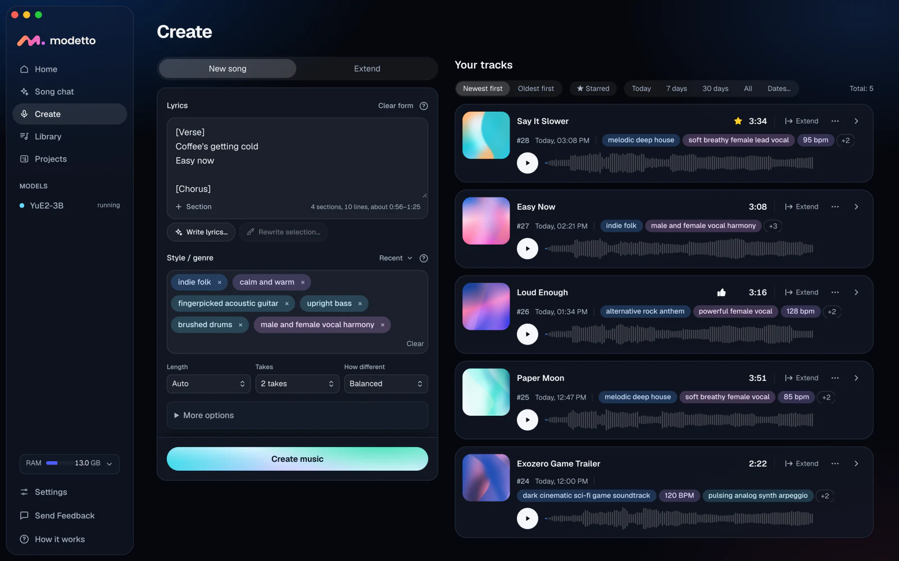
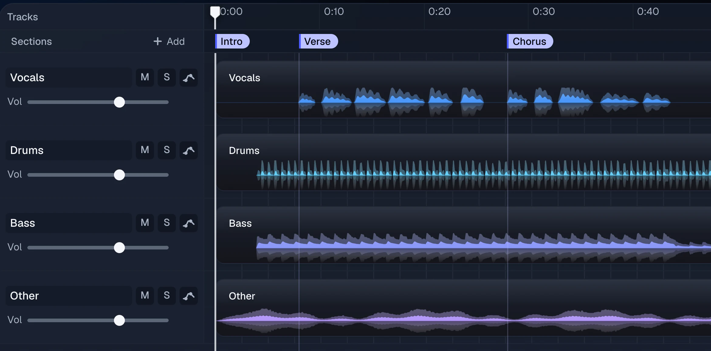
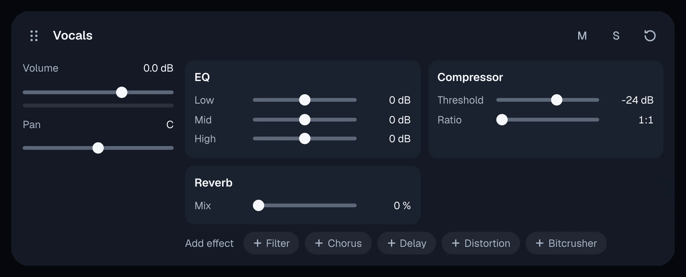

# Modetto

**Write the lyrics. Your Mac generates the song.**

Modetto is a local AI music generator for Mac with Apple Silicon. It makes whole songs with vocals from your lyrics and a style, with the YuE2 model. Extend them, cover them, split them into stems and finish them in a multitrack editor.

**[Join the free beta](https://modetto.app/?utm_source=github&utm_medium=readme#download)** | [Listen to songs made in Modetto](https://modetto.app/?utm_source=github&utm_medium=readme#listen)



## Ask for the song in your own words

Describe it in Song chat, where Google's Gemma 4 plans it on your Mac: a title, a style line, the lyrics, the length and how many takes. Change the plan in the chat, then press Make the song.

Or ask Claude, ChatGPT Codex or another agent you already use. Either way the song ends up in your Library.

- Songs from an agent wait in the same queue as yours, and the app shows who sent them.
- Agents can read your ratings and notes before they suggest the next take.
- Setup, licences and settings stay with you, in the app.

## Command line and MCP

Do the same from a terminal or over MCP: make songs, split them into stems and save the files. Add `--json` to any command to get its answer as JSON.

```sh
# make a song
modetto render --style "melodic house, soft male vocal" --lyrics lyrics.txt

# vocals, drums, bass, other
modetto split 154 --wait

# save the files
modetto get 154 --stems --midi --out ~/Music/Modetto

# read what you thought of earlier takes
modetto feedback --search modetto/ --quality
```

The app puts the command at `~/Library/Application Support/modetto-desktop/bin/modetto`. The website has [instructions to give your agent](https://modetto.app/?utm_source=github&utm_medium=readme#agent-setup).

## What else it does

**Write.** Type your lyrics with `[Verse]` and `[Chorus]` tags, describe the style in a few words, and YuE2-3B generates the whole song. Ask for up to six takes at once and keep the one you like.

**Extend and cover.** Extend adds a new part to the end of a track, or rewrites it from any point you pick. Cover reads the melody of a track, writes it out as notes you can edit, and generates a new song around it.

**Stems and MIDI.** Demucs splits a track into vocals, drums, bass and other, and opens the result in the editor as a four-track project. MuScriptor turns the full mix or a single stem into MIDI.



**Edit and export.** Mark sections, draw volume envelopes, shift pitch in semitones, and record over the top. Each track has EQ, compression and reverb. Export a master at -14 or -16 LUFS, or the stems and a DAWproject file for your DAW.



**Library.** Tag a track red in Modetto and its audio file gets the red tag in Finder. Search titles, style tags, lyrics and track numbers.

## What you need

- A Mac with an Apple Silicon M-series chip and macOS 13.3 or later. We recommend 16 GB of memory or more.
- About 13 GB of disk for the models, plus room for your tracks.
- An internet connection to download the models once.
- For Song chat, which is optional: Ollama and a Gemma 4 model. The default model takes about 18 GB, so we recommend 32 GB of memory. On 16 GB, use a smaller one such as `gemma4:e4b`.

Making songs, editing and exporting all happen on your Mac.

## This repository

This page is for finding Modetto and reporting problems. The app's source code is not published here.

- **Found a bug?** Open an issue.
- **Found a security problem?** Write to hello@modetto.app instead of opening an issue.

[Models and licences](https://modetto.app/#models) | [Privacy](https://modetto.app/privacy)
